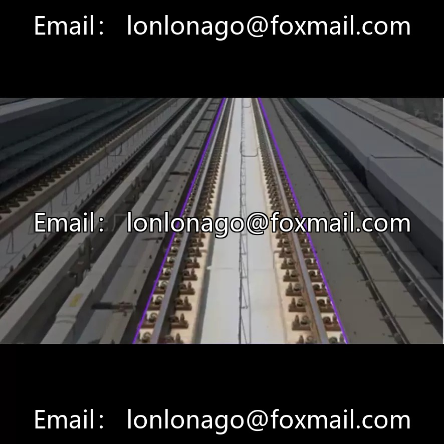
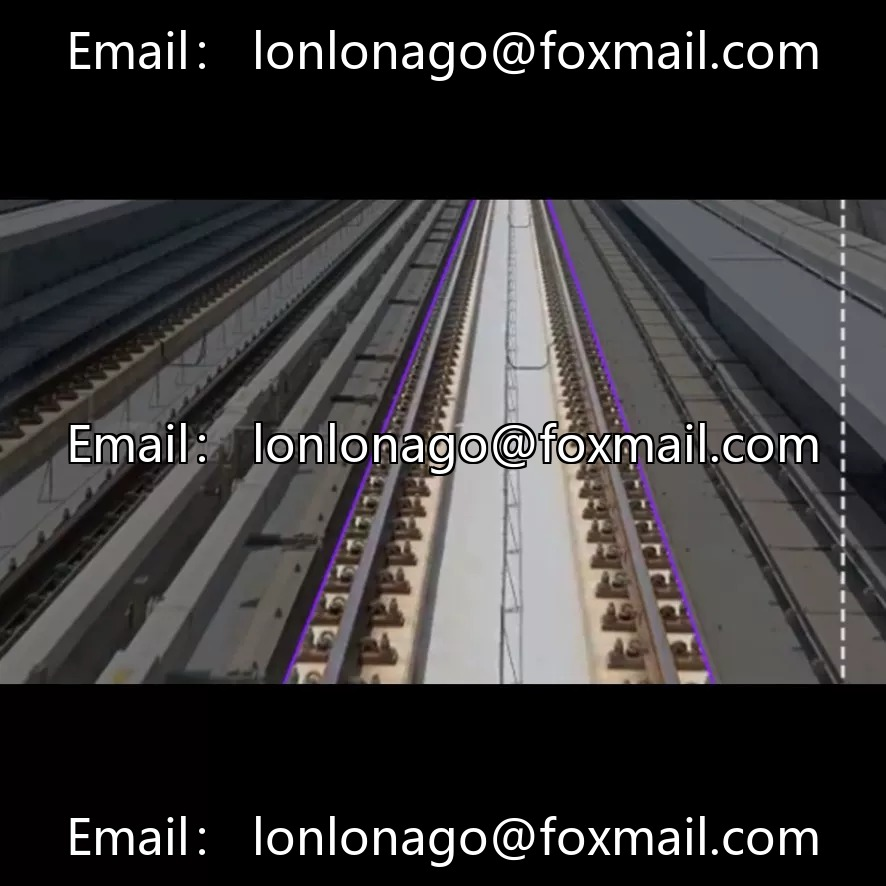
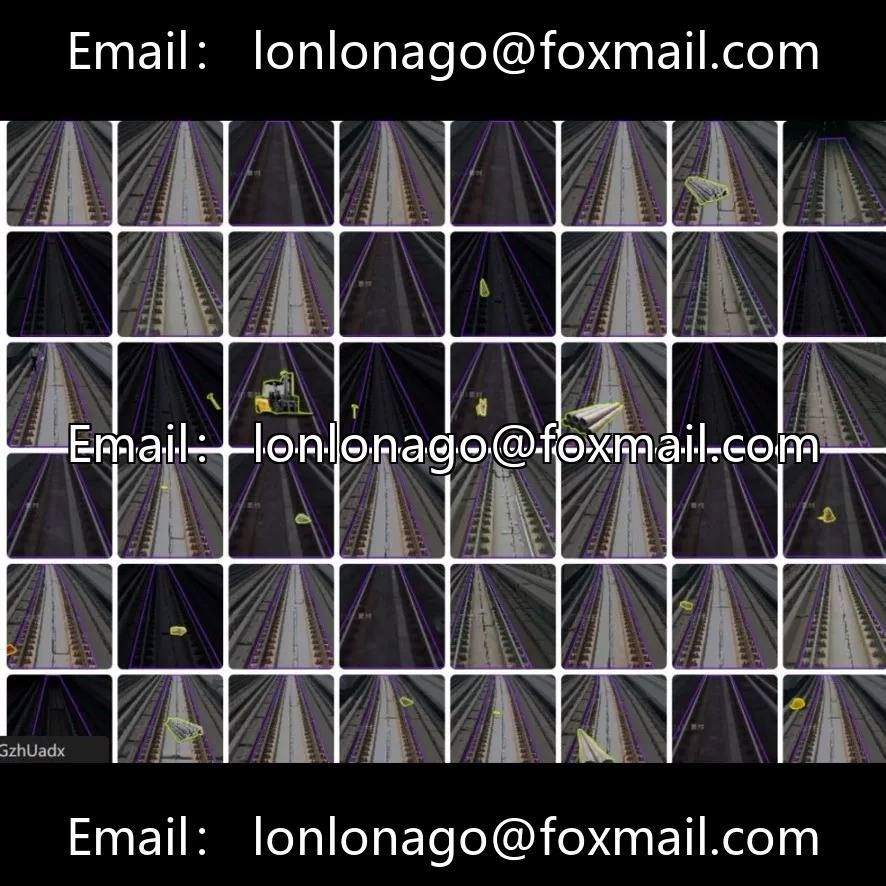

# Railway Object Segmentation Dataset | YOLO format - 200 images in 2 classes (instance segmentation)

## Body

Railway Object Segmentation Dataset | YOLO format - 200 images in 2 classes (instance segmentation)

The dataset consists of approximately 200 images of railway tracks, labeled in the format of YOLO instance segmentation (polygon masks), with a total of 2 classes: Rail (track) and ForeignObject (foreign object). Suitable for scenarios such as railway safety monitoring, intelligent operation and maintenance, and track inspection robots.

Instance segmentation annotation, with higher precision than target detection boxes, capable of calculating the relative position of foreign objects and tracks. The scene covers a variety of lighting conditions, industrial-grade compatibility, and supports training with segmentation models such as YOLOv8-seg and YOLOv11. The sample size is insufficient. It is recommended to use data augmentation or transfer learning in conjunction with this approach.

Virtual materials, once sold, are non-refundable.
Interested friends, click "I want" to proceed.

## Images

## Payment

Here is a pay link on Stripe ( https://buy.stripe.com/3cs8yP7sY87d0vu9AB ). Please contact me lonlonago@foxmail.com after funding $89, and I will send you a complete data files , thank you!

